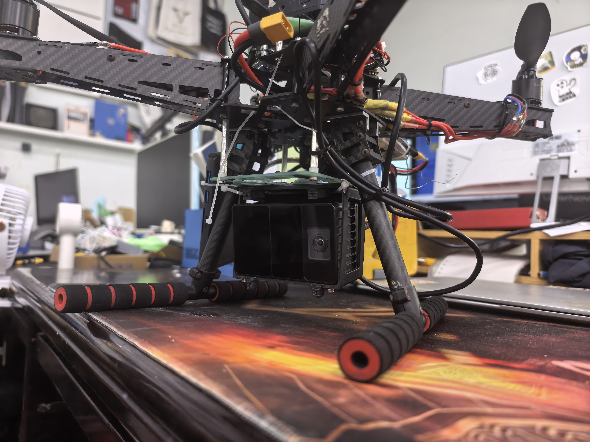
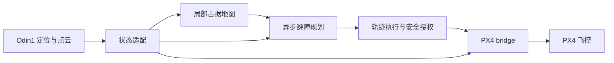

# ODIN UAV Navigation

**华南虎实验室 · 留形科技合作项目**

以 Odin1 原生定位与点云为输入，连接 ROS 2 局部避障规划、独立轨迹执行与 PX4 飞控。提供同一套导航核心的实机部署、Gazebo 仿真和飞行记录回放。



| 仿真飞行测试 | 实机飞行测试 |
| :---: | :---: |
| 视频待提供 | 视频待提供 |
| Gazebo 环境、局部地图与规划轨迹 | 真实场地、外部视角与导航画面 |

## 系统



- **设备接入**：机体参考点转换、时间配对、世界系点云处理和健康检查。
- **在线导航**：局部建图、异步规划、轨迹交接和连续目标任务。
- **工程部署**：显式启用外部定位与控制，遥控接管，录包和首故障快照。
- **统一验证**：实机和仿真使用同一导航实现；仿真定位来源为 Gazebo 真值。

Odin 实机驱动由用户在独立环境安装和启动。本仓库不包含驱动、SDK、下载脚本或其版本约束；只消费 ROS 标准消息。

## 快速开始

| 路径 | 环境 | 构建 | 启动 |
|---|---|---|---|
| 实机观察 | Ubuntu 22.04 / ROS 2 Humble | `bash scripts/build.sh --real` | `bash scripts/run_real.sh mode:=observe rviz:=true` |
| 仿真 | Ubuntu 24.04 / ROS 2 Jazzy / Gazebo Harmonic | `bash scripts/build.sh --sim` | `bash scripts/run_sim.sh` |
| 记录回放 | 已构建的实机环境 | 无需设备连接 | `bash scripts/play_bag.sh /path/to/bag --once` |

首次使用需先准备系统依赖；仿真还需要 PX4 SITL、DDS Agent、NVIDIA GPU 和 RGL。详细命令见下方“部署与运行”。两种构建分别放在 `build/real`、`build/sim` 和 `install/real`、`install/sim`，不可混用消息或安装环境。

默认实机配置未标定，只允许诊断输出。完成本机安装配置后，才能显式启用定位与控制；不会自动解锁、起飞或修改飞控参数。

## 仿真验证

在 dense / seed 17 森林中，aggressive 配置完成起飞、导航至 `(24,6,2.3)`、降落上锁，到点真值误差约 **0.128 m**。这些数据来自 Gazebo / PX4 SITL，不是设备定位精度或实飞性能。系统架构、仿真参数和验证边界见[技术报告 PDF](docs/TECHNICAL_REPORT.pdf)。

## 目录

```text
src/             导航、状态适配、执行、PX4 接口、RViz 与启动编排
config/          标定模板、样机示例、实机与仿真参数
simulation/      Odin 传感器仿真与基础场景，不含实机驱动
scripts/         构建、启动、依赖准备、录包和回放
dependencies/    系统依赖、PX4 接口来源与仿真依赖
assets/          实机照片和技术报告图表
```

部署操作集中在本页，架构、仿真参数与验证信息集中在 `docs/TECHNICAL_REPORT.pdf`。本地运行数据写入忽略目录，不随源码分发。保留上游版权与许可，见 [LICENSE](LICENSE) 和 [THIRD_PARTY_NOTICES.md](THIRD_PARTY_NOTICES.md)。

## 部署与运行

本工程只面向 Odin1。设备驱动独立运行，不需要 source 驱动工作空间。导航仅依赖标准 `nav_msgs/Odometry` 与 `sensor_msgs/PointCloud2`；系统不会安装、选择或重启真实设备驱动。

建议将源码放在无空格、无中文的路径，例如 `~/odin-uav-navigation`。ROS 消息生成工具在部分环境下不能正确处理中文路径。以下命令均在仓库根目录执行。

### 1. 实机环境

部署基线是 Ubuntu 22.04 / ROS 2 Humble。先完成 ROS 安装，再安装附加依赖并构建：

```bash
xargs -a dependencies/system-packages-real.txt sudo apt-get install -y
bash scripts/build.sh --real
```

本机只有 Jazzy 时可显式使用 `SCUT_ROS_DISTRO=jazzy` 做软件构建及回归；不因此改变实机已验证的软件/固件组合。构建会检查随仓库提供的 PX4 实机消息快照，更换飞控固件前需核对其接口。

#### Odin 输入契约

按设备自身文档启动驱动，使其与导航处于同一 ROS domain（实机默认 0）。导航不检查厂商版本号，而检查输入接口、时效与来源唯一性。

| 输入 | 类型与要求 |
|---|---|
| `/odin1/odometry_highfreq` | `nav_msgs/msg/Odometry`，`odom → odin1_base_link`，时间戳对应已对齐的采样时刻 |
| `/odin1/cloud_slam` | `sensor_msgs/msg/PointCloud2`，`odom` 世界系点云，XYZ 字段有效，不重复施加机体变换 |
| 原生速度 | 配置按世界系线速度、源机体系角速度解释；部署前通过运动核验 |
| 时钟 | 设备采样时间与主机 ROS 时间轴一致，不用回调时间改写旧样本 |
| 点云语义 | 必须核实为适合当前观测建图的点集；若含历史累积，不能直接把历史点都用于当前射线清空 |

驱动应启用原生里程计和 SLAM 点云；已验证配置采用主机时间对齐模式。实际设备配置在驱动侧维护。话题或 frame 不同时，修改本机 `source_config`，不要修改算法中硬编码约定或同时运行两个输入发布者。

#### 安装外参与飞控

1. 从 `config/real/odin1.yaml` 复制本机配置到 `run/config/`，测量机体、定位与点云参考点。模板外参为单位变换，`calibrated=false`，不代表可飞。
2. 填写 `odom_sensor_*`（机体到定位源）、`sensor_*`（机体到点云原点），确认速度坐标、点云 frame 和时间。两组外参不能当作相同原点。
3. `config/examples/odin1_airframe_20261105.yaml` 仅对应既有样机的名义安装，不能作为所有飞机的标定。
4. 核对 `config/real/odin1_navigation.yaml` 的包络、地面与高度边界，以及真实旋翼外廓。0.5 m 自身过滤会屏蔽该范围内的真实障碍，需核验近场条件。
5. 核对 PX4 的外部定位融合、外部位置杆臂、RC 模式和失效保护参数。此工程输出机体原点，不能再重复补偿传感器杆臂；不会自动更改飞控参数。

先独立运行或确认唯一 DDS Agent。已有系统服务时直接复用；确需准备新实例时：

```bash
bash scripts/setup/install_agent.sh
PX4_SERIAL_DEV=/dev/px4_fcu PX4_SERIAL_BAUD=921600 bash scripts/run_dds_agent.sh
```

串口权限、稳定设备名和 PX4 DDS 设置由部署者配置。`packaging/systemd/` 提供可编辑的服务模板，不会自动安装服务。

#### 观察、定位与控制

```bash
## 仅读取设备及飞控状态；无 PX4 输入发布者
bash scripts/run_real.sh mode:=observe rviz:=true

## 使用已核验的本机配置，仅发布外部定位
SCUT_REAL_SOURCE_CONFIG="$PWD/run/config/airframe.yaml" \
  bash scripts/run_real.sh mode:=real enable_external_odometry:=true

## 显式允许导航控制，默认仍由飞手起飞和切入 Offboard
SCUT_REAL_SOURCE_CONFIG="$PWD/run/config/airframe.yaml" \
  bash scripts/run_real.sh mode:=real enable_external_odometry:=true \
  enable_control:=true speed_profile:=baseline rviz:=true
```

每次只运行一套导航入口，不要叠加运行上面三个示例。速度档为 `conservative`、`baseline`、`aggressive`；最后一个是实验档，具体约束见报告。实机界面用于暂存/预览目标、显式开始和暂停；实机起降服务不启用。飞手起飞并悬停后，满足就绪条件，开始任务并由遥控器切入 Offboard。

只读地面检查：

```bash
bash scripts/check_odin.sh --duration 20
## 仅检查数据/融合链路；此结果不替代完整预飞检查
bash scripts/check_odin.sh --scope links --duration 20
```

控制门限或定位故障不能通过新目标绕过。确认已着陆、上锁、源数据有效且静止后，才能按诊断处理并调用 `/navigation/reset_control_fault`；适配器已锁存的定位跳变需先处理来源并重启适配器。

### 2. Odin 仿真

环境：Ubuntu 24.04、ROS 2 Jazzy、Gazebo Harmonic、Linux x86_64 和兼容 NVIDIA GPU。仿真使用理想深度/图像/IMU及 Gazebo 机体真值，不运行设备内部定位算法。

```bash
xargs -a dependencies/system-packages-sim.txt sudo apt-get install -y
## 已有匹配 PX4 源码时，改为设置 PX4_ROOT，跳过下载
python3 scripts/setup/fetch_px4.py
PX4_GZ_HEADLESS=1 make -C .deps/PX4-Autopilot px4_sitl_default
SCUT_PROFILE=sim bash scripts/setup/install_agent.sh
bash scripts/build.sh --sim
bash scripts/run_sim.sh
```

PX4 源码也可通过 `PX4_ROOT=/path/to/PX4-Autopilot` 或忽略文件 `dependencies/local.json` 指定，格式参考 `dependencies/local.example.json`。消息生成器核对仿真版本，模型生成器不修改外部 PX4 源码。RGL 是仿真 GPU 依赖，其二进制和头文件按仿真模块清单获取与校验，不是 Odin 实机 SDK。

```bash
## Odin 密集森林，2 m/s 规划配置
bash scripts/run_sim.sh world:=benchmark forest_density:=dense forest_seed:=17 \
  flight_profile:=aggressive yaw_mode:=follow
## 无界面运行
bash scripts/run_sim.sh headless:=true rviz:=false
```

在 RViz 工作台等待就绪，显式起飞，暂存目标、预览、开始导航，再降落。常用森林目标为 `(24,6,2.3)`；实际能否规划取决于当前地图。`world` 支持 `test`、`forest`、`forest_long`、`benchmark`。仿真默认允许未知空间，实机默认不允许，比较结果时须记录该差异。

仿真默认 ROS domain 73、Gazebo partition `odin_navigation`、PX4 实例 7、DDS UDP 8897。并行运行时分别指定 `SCUT_ROS_DOMAIN_ID`、`SCUT_GZ_PARTITION`、`instance`、`dds_port`，避免与其他进程混用。只停止本次启动的进程。

### 3. 环境与构建隔离

```bash
## 实机软件环境
source scripts/env.sh
source "$SCUT_INSTALL/local_setup.bash"
## 仿真软件环境（建议新终端）
export SCUT_PROFILE=sim
source scripts/env.sh
source "$SCUT_INSTALL/local_setup.bash"
```

实机和仿真分别使用 `install/real`、`install/sim`；入口会检查 PX4 消息的 profile 和来源。切换系统 ROS 环境使用新终端，避免旧 Python/动态库环境串入。不要搬运另一台电脑的 install 二进制目录，目标机器上重新构建。

### 4. 录包、回放与故障取证

```bash
## 实机起飞前开启；结束时 Ctrl+C 等待收尾
bash scripts/record.sh --real
## 仿真记录
SCUT_PROFILE=sim bash scripts/record.sh
## 已记录导航结果的可视化回放，不启动控制进程
bash scripts/play_bag.sh /path/to/bag --once
```

录包写入 `run/bags/`，运行参数、话题列表、旁路事件、boot ID 和写盘心跳写入 `run/metadata/`。SQLite 使用 WAL/FULL 和 16 MiB 内存缓存；能降低异常退出丢尾部风险，不保证硬件断电时零损失。正常结束后检查 `metadata.yaml`、分包大小和摘要。PX4 ULog、飞控参数及视频另行保存。

回放默认为隔离 domain 193，显式白名单排除 `/fmu/*`，不会向真实飞控发布输入。仿真录包回放可设置 `SCUT_PROFILE=sim`。仅作可视化的循环回放与重新运行定位算法不同；不要将循环时钟送入正在工作的控制链。

原始定位跳变的独立快照在 `run/odin_faults/<epoch>/fault.json`，包含触发数值和前后约 2 秒原始位姿；ROS 同时发布 `/navigation/localization_fault`。该机制改善下一次取证，不能恢复过去缺失的数据。源码仓库不保存运行日志或历史复盘目录，实验结论统一写入技术报告。

### 5. 常见问题

| 现象 | 检查方向 |
|---|---|
| 默认配置一直未就绪 | 检查本机外参和 `calibrated`；模板本来就不会放行 |
| 设备有输出但导航无数据 | 检查 domain、话题类型、frame、时间基准、唯一发布者及健康原因 |
| 坐标或点云重影 | 区分世界系 SLAM 云与传感器坐标云，避免重复变换；核对时间配对 |
| `Trajectory executor expired` | 对照授权、规划耗时、执行状态和桥快照，不能仅凭错误名判断根因 |
| `localization position jump` | 读取首故障快照，位置或姿态均可能触发；不直接放宽门限 |
| 仿真提示消息来源不符 | 重新构建 `--sim` 并使用仿真入口，不复用实机消息安装 |
| 缺少 GPU / RGL | 仅影响仿真；实机导航构建不需要 Gazebo、GPU 插件或设备 SDK |
