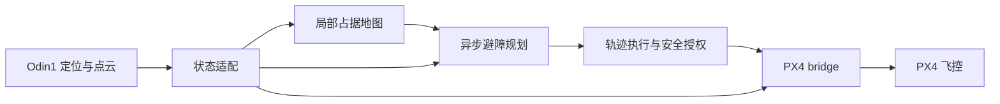

# ODIN UAV Navigation

**华南虎实验室 · 留形科技合作项目**

以 Odin1 原生定位与点云为输入，连接 ROS 2 局部避障规划、独立轨迹执行与 PX4 飞控。提供同一套导航核心的实机部署、Gazebo 仿真和飞行记录回放。


| 仿真飞行测试 | 实机飞行测试 |
| :---: | :---: |
| 视频待提供 | 视频待提供 |
| Gazebo 环境、局部地图与规划轨迹 | 真实场地、外部视角与导航画面 |

## 系统



- **设备接入**：机体参考点转换、时间配对、世界系点云处理和健康检查。
- **在线导航**：局部建图、异步规划、轨迹交接和连续目标任务。
- **工程部署**：显式启用外部定位与控制，遥控接管，录包和首故障快照。
- **统一验证**：实机和仿真使用同一导航实现；仿真定位来源为 Gazebo 真值。

Odin 实机驱动由用户在独立环境安装和启动。本仓库不包含驱动、SDK、下载脚本或其版本约束；只消费 ROS 标准消息。实验使用的设备软件版本记录在[技术报告](docs/TECHNICAL_REPORT.md)。

## 快速开始

| 路径 | 环境 | 构建 | 启动 |
|---|---|---|---|
| 实机观察 | Ubuntu 22.04 / ROS 2 Humble | `bash scripts/build.sh --real` | `bash scripts/run_real.sh mode:=observe rviz:=true` |
| 仿真 | Ubuntu 24.04 / ROS 2 Jazzy / Gazebo Harmonic | `bash scripts/build.sh --sim` | `bash scripts/run_sim.sh` |
| 记录回放 | 已构建的实机环境 | 无需设备连接 | `bash scripts/play_bag.sh /path/to/bag --once` |

首次使用需先准备系统依赖；仿真还需要 PX4 SITL、DDS Agent、NVIDIA GPU 和 RGL。详细命令见[部署说明](docs/DEPLOYMENT.md)。两种构建分别放在 `build/real`、`build/sim` 和 `install/real`、`install/sim`，不可混用消息或安装环境。

默认实机配置未标定，只允许诊断输出。完成本机安装配置后，才能显式启用定位与控制；不会自动解锁、起飞或修改飞控参数。

## 飞行结果

已有样机记录包含一次约 9.71 秒的到点任务：目标约位于前方 12.31 m，完成时基于 Odin 定位估计的目标误差约 0.127 m；到点后成功开始下一任务。后续航段出现定位跳变保护，完整实验条件、跟踪偏差和限制统一见技术报告，不以单次结果代表可靠性认证。

## 目录

```text
src/             导航、状态适配、执行、PX4 接口、RViz 与启动编排
config/          标定模板、样机示例、实机与仿真参数
simulation/      Odin 传感器仿真与基础场景，不含实机驱动
scripts/         构建、启动、依赖准备、录包和回放
dependencies/    系统依赖、PX4 接口来源与仿真依赖
assets/          实机照片和技术报告图表
```

操作说明集中在 `docs/DEPLOYMENT.md`，架构、版本、验证信息集中在 `docs/TECHNICAL_REPORT.md`。本地运行数据写入忽略目录，不随源码分发。保留上游版权与许可，见 [LICENSE](LICENSE) 和 [THIRD_PARTY_NOTICES.md](THIRD_PARTY_NOTICES.md)。
