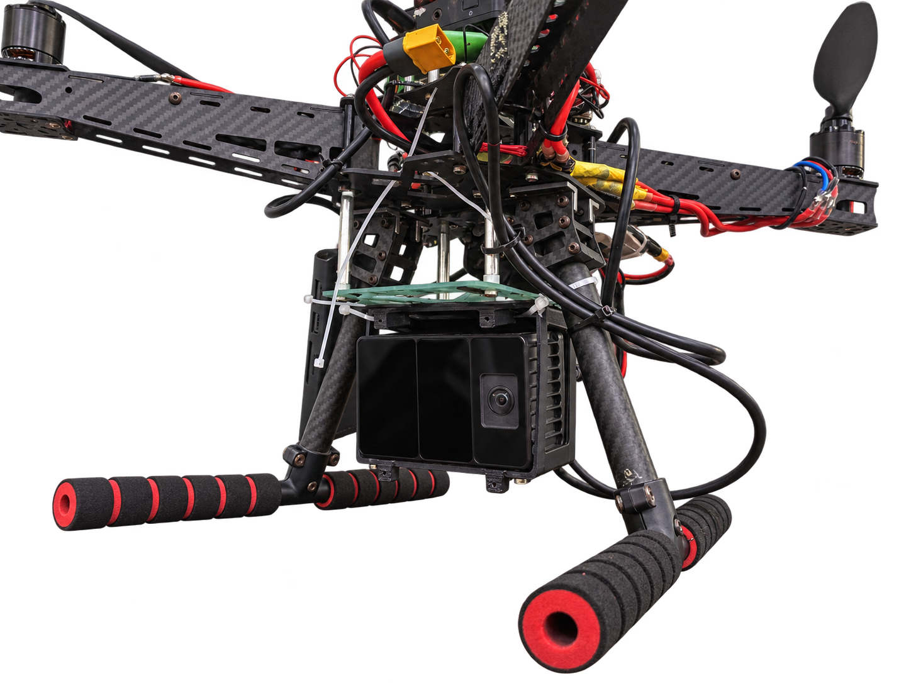
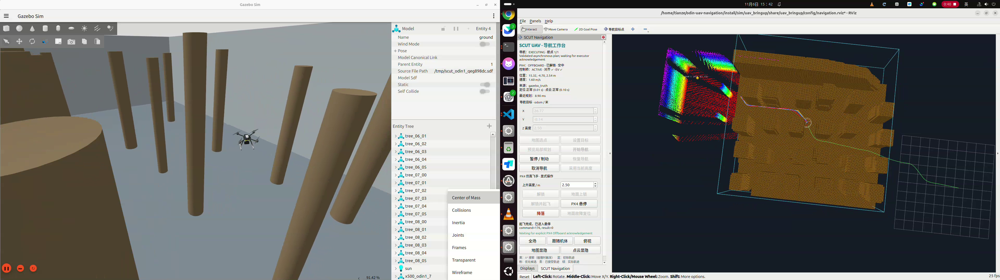
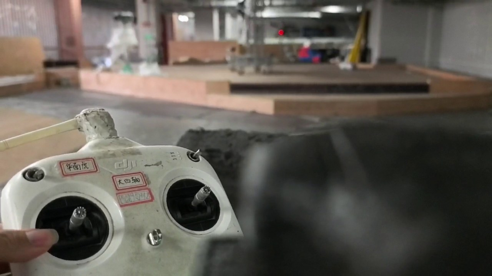

# ODIN UAV Navigation

**华南虎战队 · 华南理工大学机器人实验室**

使用留形科技 Odin1 作为定位与点云输入，连接 ROS 2 局部避障规划、独立轨迹执行与 PX4 飞控。同一套导航核心支持实机部署、Gazebo 仿真和飞行记录回放。



| 仿真飞行测试 | 实机飞行测试 |
| :---: | :---: |
| [](assets/simulation-flight.mp4) | [](assets/real-flight.mp4) |
| [播放仿真测试视频 · 约 91 秒](assets/simulation-flight.mp4) | [播放实机测试视频 · 约 55 秒](assets/real-flight.mp4) |
| Gazebo 与 RViz 仿真录屏 | 室内场地实机测试 |

## 快速开始

| 路径 | 环境 | 构建 | 启动 |
|---|---|---|---|
| 实机观察 | Ubuntu 22.04 / ROS 2 Humble | `bash scripts/build.sh --real` | `bash scripts/run_real.sh mode:=observe rviz:=true` |
| 仿真 | Ubuntu 24.04 / ROS 2 Jazzy / Gazebo Harmonic | `bash scripts/build.sh --sim` | `bash scripts/run_sim.sh` |
| 记录回放 | 已构建环境 | 无需设备连接 | `bash scripts/play_bag.sh <bag> --once` |

首次构建先安装依赖：

```bash
# 实机
xargs -a dependencies/system-packages-real.txt sudo apt-get install -y
bash scripts/build.sh --real

# 仿真（需要 NVIDIA GPU 与 RGL）
xargs -a dependencies/system-packages-sim.txt sudo apt-get install -y
python3 scripts/setup/fetch_px4.py              # 或设置 PX4_ROOT 跳过下载
PX4_GZ_HEADLESS=1 make -C .deps/PX4-Autopilot px4_sitl_default
SCUT_PROFILE=sim bash scripts/setup/install_agent.sh
bash scripts/build.sh --sim
```

实机与仿真分别使用 `build/real`、`build/sim` 和 `install/real`、`install/sim`，不能混用。切换环境：

```bash
source scripts/env.sh
source "$SCUT_INSTALL/local_setup.bash"
# 仿真终端先 export SCUT_PROFILE=sim
```

## 实机运行

Odin 驱动需按设备文档独立安装启动，并与导航处于同一 ROS domain。导航只消费标准消息，要求：

| 输入 | 要求 |
|---|---|
| `/odin1/odometry_highfreq` | `nav_msgs/Odometry`，`odom → odin1_base_link`，时间戳为已对齐采样时刻 |
| `/odin1/cloud_slam` | `sensor_msgs/PointCloud2`，`odom` 世界系点云，XYZ 有效 |
| 其他 | 单一发布者、时间基准一致、点云语义经过核实 |

标定与配置：

1. 从 `config/real/odin1.yaml` 复制到 `run/config/`，填写 `odom_sensor_*`（机体到定位源）与 `sensor_*`（机体到点云原点）。
2. 默认模板 `calibrated=false`，只允许观察/诊断；`config/examples/odin1_airframe_20261105.yaml` 仅对应既有样机，需按本机复测。
3. 核对 `config/real/odin1_navigation.yaml` 的包络、高度边界和旋翼外廓；0.5 m 自身过滤会屏蔽该范围内的真实障碍。

启动：

```bash
# 只观察设备与飞控状态
bash scripts/run_real.sh mode:=observe rviz:=true

# 仅发布外部定位
SCUT_REAL_SOURCE_CONFIG="$PWD/run/config/airframe.yaml" \
  bash scripts/run_real.sh mode:=real enable_external_odometry:=true

# 显式允许导航控制（仍由飞手起飞并切入 Offboard）
SCUT_REAL_SOURCE_CONFIG="$PWD/run/config/airframe.yaml" \
  bash scripts/run_real.sh mode:=real enable_external_odometry:=true \
  enable_control:=true speed_profile:=baseline rviz:=true
```

导航不会自动解锁、起飞或修改飞控参数；飞手起飞并悬停后，由遥控器切入 Offboard。速度档：`conservative`、`baseline`、`aggressive`（实验档）。

## 仿真

```bash
export SCUT_PROFILE=sim

# dense 森林，aggressive 配置
bash scripts/run_sim.sh world:=benchmark forest_density:=dense forest_seed:=17 \
  flight_profile:=aggressive yaw_mode:=follow

# 无界面
bash scripts/run_sim.sh headless:=true rviz:=false
```

仿真默认 ROS domain 73、Gazebo partition `odin_navigation`、PX4 实例 7、DDS UDP 8897；并行时分别覆盖 `SCUT_ROS_DOMAIN_ID`、`SCUT_GZ_PARTITION`、`instance`、`dds_port`。仿真使用 Gazebo 机体真值与 RGL 生成点云，不运行 Odin 内部定位。

## 多航次仿真结果

dense 随机森林中，4 个随机种子 × 2 个目标点连续 8 个 aggressive 航次：**8/8 完成到点、自动降落与上锁**。执行时间 18.97±2.16 s，到点误差（Gazebo 真值）0.123±0.022 m，跟踪 RMSE 0.137±0.029 m（p95 0.258±0.037 m），最大水平速度 2.20±0.06 m/s，最小树干净距 0.747±0.113 m。数据来自 Gazebo / PX4 SITL，不是 Odin1 定位精度或实机性能。详见[技术报告 PDF](docs/基于 Odin1 定位的无人机自主避障导航.pdf)。

## 目录

```text
src/             导航、状态适配、执行、PX4 接口、RViz 与启动编排
config/          标定模板、样机示例、实机与仿真参数
simulation/      Odin 传感器仿真与基础场景，不含实机驱动
scripts/         构建、启动、依赖准备、录包和回放
dependencies/    系统依赖、PX4 接口来源与仿真依赖
assets/          实机照片、抠图、仿真/实机测试视频及封面
```

## 录包与回放

```bash
# 实机起飞前开启；结束 Ctrl+C 等待收尾
bash scripts/record.sh --real

# 仿真记录
SCUT_PROFILE=sim bash scripts/record.sh

# 隔离回放（domain 193，白名单排除 /fmu/*）
bash scripts/play_bag.sh /path/to/bag --once
```

录包写入 `run/bags/`，元数据写入 `run/metadata/`。定位连续性快照在 `run/odin_faults/<epoch>/fault.json`，ROS 同时发布 `/navigation/localization_fault`；仅用于事后取证，不能恢复缺失数据。运行日志和历史复盘不随源码分发。

## 常见问题

| 现象 | 检查方向 |
|---|---|
| 默认配置一直未就绪 | 检查本机外参、`calibrated` 和启动入口；模板不会直接放行 |
| 设备有输出但导航无数据 | 检查 domain、话题类型、frame、时间基准与唯一发布者 |
| 坐标或点云重影 | 区分世界系 SLAM 云与传感器云，核对时间配对，避免重复变换 |
| `Trajectory executor expired` | 对照授权、规划耗时、执行状态和 bridge 快照定位原因 |
| 仿真提示消息来源不符 | 重新 `build.sh --sim` 并使用仿真入口，不复用实机消息安装 |

更多设计、实验与验证边界见[技术报告 PDF](docs/基于 Odin1 定位的无人机自主避障导航.pdf)。上游许可见 [LICENSE](LICENSE) 与 [THIRD_PARTY_NOTICES.md](THIRD_PARTY_NOTICES.md)。
