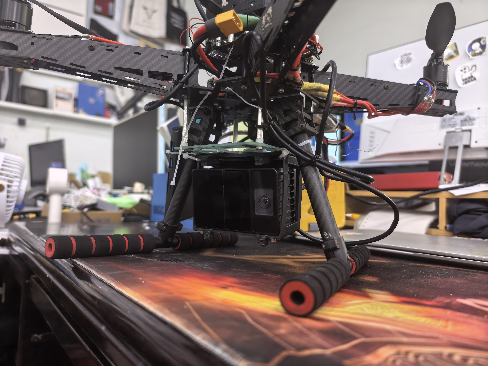
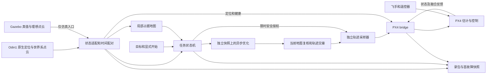
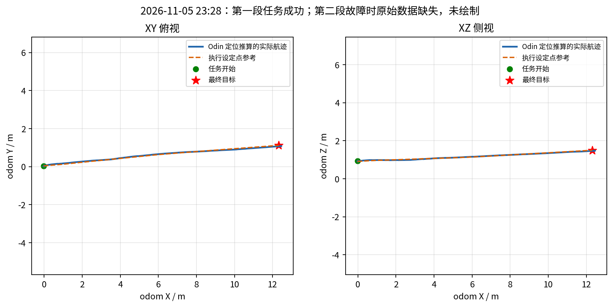

# 基于 Odin1 的无人机自主避障导航

**华南虎实验室 · 留形科技合作项目**

系统实现、仿真与实机验证 · 2026-11-06

## 摘要

本项目以 Odin1 原生定位与点云为输入，将 ROS 2 状态适配、局部占据地图、EGO-Planner-v2 轨迹优化、独立轨迹执行和 PX4 Offboard 接入组织为可部署的单无人机导航系统。工程重点包括机体参考点转换、采样时间保持、世界系点云处理、异步规划与安全授权续发、连续目标任务，以及异常退出时的独立取证。

系统保留真实设备与 Gazebo 两条运行路径。实机消费外部驱动发布的标准消息，仓库不包含设备驱动或 SDK，也不通过版本锁限制设备软件。仿真使用理想传感器和机体真值，用于验证导航与控制链，不等价于设备定位算法仿真。

已有样机记录显示，一段目标位于前方约 12.31 m 的任务在约 9.71 s 内完成，基于 Odin 定位估计的到点误差约 0.127 m；到点后成功开始下一任务，随后触发位姿连续性保护。本文同时说明这些结果的来源、测量局限及未闭环问题，不将单次案例写成成功率或绝对定位精度结论。

## 1. 项目范围与平台

图 1：本项目的 Odin1 机载安装实物。照片展示实际挂载，不用照片像素推断尺寸、质量或精确外参。仿真安装采用机腹下倾 30°，实机样例为下倾 10°，两者分别配置。

本项目负责设备输出到飞控之间的导航工程：飞手完成起飞和模式切换，操作者指定目标并显式开始，系统完成局部避障规划和轨迹执行。它不声明具备开机到降落的全自主任务能力，也不将厂商定位算法、EGO 原始优化方法或 PX4 控制器归为项目原创。

### 实验环境记录

以下版本仅描述已留存实验的设备软件组合，不是导航构建要求，也不会由代码自动下载或强制检查。

| 项目 | 已留存信息 |
|---|---|
| 实机主机软件 | Ubuntu 22.04 / ROS 2 Humble；完整主机、机架、电池与载荷型号未随材料提供 |
| Odin 设备软件 | 兼容 ROS 驱动提交 `388440c977af579ea81c3c242ab36fb958d3be82`，驱动报告 0.11.0，观测固件 0.12.0；SDK 与该兼容检出配套 |
| 驱动来源 | [留形科技 Odin ROS 驱动](https://github.com/manifoldsdk/odin_ros_driver)，由设备侧独立部署 |
| SDK 标识 | 实验包记录 AMD 库 SHA256 `09ca51c0f21f4af60fe801ff8e85eca4657536c46ec3079312cb6dd1760238af`；ARM 库 SHA256 `66203d159235c0f9514e4e154c82cb5de42facd1a3a5b226dbaea812f955b73c`；不据此声明 ARM 实机已验证 |
| PX4 | 实机消息来自 release/1.15 对应快照，完整飞控固件及参数另行归档；消息来源保留在工程中以避免接口混用 |
| DDS | 留存实机部署采用 Micro XRCE-DDS Agent 2.4.2、串口样例 921600 baud |
| 样机安装 | 机体到定位参考点 `[0,0,-0.10]` m、pitch +10°，是已接受名义值，不是精密测量 |
| 仿真环境 | Ubuntu 24.04 / ROS 2 Jazzy / Gazebo Harmonic、X500、Odin 理想传感器、NVIDIA GPU 与 RGL |

共同要求是满足话题、坐标、时间和数据有效性契约。更换设备软件时应核对这些接口及实际融合行为，不能仅凭版本号认为兼容。硬件完整清单、场地尺寸、视频和独立真值信息尚未随本次材料提供。

## 2. 系统架构

图 2：真实设备和仿真是互斥输入，共用导航、执行与飞控接入核心。实机源为 Odin1，仿真源为 Gazebo 真值，不同时运行两个来源。

| 模块 | 工程职责 |
|---|---|
| 状态适配器 | 参考点、坐标和协方差转换，当前扫描配准，自身过滤，健康检查与首故障快照 |
| 地图与规划器 | 占据更新、搜索、轨迹优化、候选验证、重规划及制动 |
| 轨迹执行器 | 编号/会话确认、接管连续性检查、安全授权检查、50 Hz 目标采样 |
| PX4 bridge | 外部定位发送、地面对齐、Offboard 接管、数据和控制保护 |
| RViz 与运行入口 | 显式目标操作、状态展示、实机/仿真环境选择 |

实机驱动属于外部设备层。仿真插件属于 Gazebo 资源，不包含真实设备驱动或定位 SDK。真实/仿真构建采用独立安装目录及 PX4 消息来源检查，避免在同一安装环境中替换接口后误启动另一条链。

## 3. Odin1 状态与点云适配

### 3.1 坐标和参考点

设备里程计描述定位参考点，导航控制使用机体参考点。令 `T_WS` 表示世界到源定位的位姿、`T_BS` 表示机体到源定位的安装变换，则：

`T_WB = T_WS × inverse(T_BS)`。

适配器同时补偿旋转杆臂造成的线速度，输出 `odom → base_link`，ROS 侧采用 FLU 机体系。速度在输出子坐标系表达，PX4 接口再进行世界与机体轴约定转换。协方差随相应变换处理；上游未提供的全零协方差保持未知，不填入虚构的高精度。

定位参考点和点云原点分开处理。样机点云原点由设备内部 `T_IL` 与安装外参组合；这一外参仍用于地图射线原点推算。公开默认配置为未标定的单位变换，报告样机配置单独提供，避免把一个安装误用于其他飞机。

### 3.2 世界系点云与时间

实机当前使用 `/odin1/cloud_slam`，其点坐标位于 `odom` 世界系，设置 `cloud_in_world=true`。不能再次对点乘机体位姿。原始云同时可录包用于对照，但导航不对 raw 云自行实施逐点去畸变。

驱动侧使用主机对齐的采样时间。适配器不重写时间戳，通过位姿历史匹配扫描；地图保存近期传感器位姿，按时间与点云配对，容忍两路 DDS 到达顺序变化。配对容差为 30 ms；适配器定位时效为 250 ms、规划器里程计时效为 300 ms、地图点云时效为 500 ms。

仍需核实不同设备模式下 SLAM 云是否含历史累积点。若包含历史点，不能把全部点当作当前扫描的光线终点来清空地图；世界坐标正确不等于观测语义正确。设备接收统计约 402 Hz 与录包统计属于不同采样层，不能直接以两者差异认定定位断流。

### 3.3 健康与连续性

健康检查包含来源唯一性、坐标、有限值、时间、安装标定和点云时效。相邻已接受位姿的位置变化超过 `max(0.5 m, 4×dt)`，或姿态旋转超过 `max(0.35 rad, 4×dt)`，将锁存故障并改变 epoch。该规则是连续性保护，不是厂商 SLAM 内部故障分类器。

当前还未完整接入原生跟踪置信度与重定位状态。点云时效仍会影响定位有效标志及 EV 发送，必须区分感知链异常和定位自身失效，不能把“消息持续更新”等同于定位可靠，也不能一概在异常时继续发布 EV。

## 4. 地图、规划与执行

### 4.1 地图和包络

实机使用 0.1 m 占据体素、每轴 0.2 m 方盒膨胀、0.5 m 机体中心球形过滤，以及严格的已知自由空间策略。计入源体素尺寸后，单个占据源的外包络为格心每轴 ±0.25 m；多个占据源可形成更大的膨胀区域。

自身过滤也会屏蔽半径内真实障碍，不能代替近场分析。旧误点不会因开启过滤自动消失，需要新的有效自由观测或滚动窗口移出。地图处理采用密集帧标记减少分配开销，显示降至 2 Hz，观测仍由有效扫描更新。

仿真包络根据模型碰撞几何与倾角余量生成，默认允许未知空间，与实机配置不同。报告比较两条链时保留这些差异，不把同名速度档视为完全相同的参数组合。

### 4.2 异步规划与交接

优化器在独立地图快照和独立缓冲上工作，主线程继续处理地图、状态与授权。候选完成后检查任务代数、session、目标、参考编号、健康状态和激活期限，并在最新地图上重新验证；取消或换目标后，旧工作结果不能恢复旧任务。

执行器报告实际执行、待接管和已撤销的轨迹编号。接管时再次验证位置、速度、加速度连续性；无有效安全授权、授权撤销或运动轨迹过期时停止指令输出。bridge 进一步检查设定点新鲜度和坐标，避免把优化成功等同于任务成功。

| 实机档位 | 规划速度上限 | 执行校验上限 |
|---|---:|---:|
| conservative | 0.45 m/s | 0.5 m/s |
| baseline | 0.9 m/s | 1.0 m/s |
| aggressive | 2.0 m/s | 2.2 m/s |

aggressive 的共享约束还包括 2 m/s² 规划加速度、2.2 m/s² 执行加速度、6 m/s³ 执行 jerk 校验上限、6 m 规划距离和 0.4 s 重规划间隔。实机仅加载共享的 planner/execution 段，不应用仿真的机体包络或 PX4 参数段。配置上限不是实测峰值。

### 4.3 任务完成与制动

末航点完成要求估计位置误差小于 0.3 m、速度小于 0.2 m/s，持续超过 0.6 s，并通过相关健康及控制检查。完成后保持，可显式开始新任务；真实故障锁存不能通过重新发点清除。

制动候选以参考轨迹未来状态生成，搜索不同持续时间并验证碰撞。这不是瞬时停车，也不能保证任意迟发现障碍下都有可行制动轨迹。点云延迟、交接时间、真实减速能力和运动跟踪偏差都影响制动余量。

## 5. 飞控接入与取证

实机可分别启用外部定位和导航控制。观察模式没有 PX4 输入发布者；仅 EV 模式发送新的有效机体样本，保留采样时间，目标频率 50 Hz。首次启动要求新鲜 DISARMED 状态，不在未知状态或空中首次启动 EV。实机 RC 路径不自动解锁、起飞、切模式或修改参数。

飞手起飞并悬停，目标暂存和显式开始后，由遥控器切入 Offboard。任务退出停止设定点和心跳，后续行为由飞手与 PX4 配置决定；不能把“退出导航”表述为“已验证自动安全降落”。

首故障快照保存触发前后原始位姿、时间、位移/转角和门限，后台原子落盘并保留前后约 2 秒样本。后续过期不覆盖首个原因。录包附带实际参数、boot ID、旁路事件及写盘心跳；SQLite 使用 WAL/FULL 和 16 MiB 缓存，正常退出及进程异常测试不等价于硬件断电零丢失保证。

## 6. 仿真与实机结果

### 6.1 仿真用途

仿真提供基础障碍和可重复生成的森林，支持目标预览、起飞、导航、连续任务和降落。之前版本的 Odin 密集森林记录覆盖三种布局、七个航段；该结果属于当时代码、几何和参数，不能自动视为本次整理后全部组合的重新验收。

本次整理的构建、接口回归和仿真启动检查见下节。仿真定位是 Gazebo 真值，验证的是导航和控制链，不用于推断 Odin 定位精度、漂移或退化性能。仿真飞行视频待提供后在首页接入。

### 6.2 留存实飞案例

2026-11-05 的留存任务包含两段导航：第一段完成到点，悬停后第二段正常开始，随后由位姿连续性保护退出。

图 3：“实际航迹”来自 Odin 定位估计，不是独立真值。此图说明到点及跟踪过程，不单独证明绕障效果；障碍布局和连续实飞视频需共同展示。视频待提供后接入首页。

| 指标 | 留存结果与定义 |
|---|---|
| 第一段执行时间 | 23:28:17.498—23:28:27.211，约 9.713 s |
| 目标位置 | `(12.31, 1.12, 1.50)` m |
| 完成时定位位置 | `(12.4274, 1.0806, 1.4738)` m |
| 到点误差 / 速度 | 约 0.127 m / 0.113 m/s，均基于定位估计 |
| 执行期可用定位 / 指令样本 | 1182 / 470 |
| 估算跟踪偏差 | 中位数 0.199 m、P95 0.476 m；帧头时间最近邻配对，最大差 40 ms |
| 第二段开始 | 23:28:38.902，成功接受下一任务 |
| 第二段直接退出 | 23:28:43.965，位姿连续性保护，epoch 增加 1 |

第二段曾发现前方膨胀占据并产生通过验证的新候选，之后发生定位保护。留存材料不支持把本轮退出归因于持续优化失败或执行器超时，也不能确定障碍来自真实物体、重影还是历史占据。

有效数据库止于 23:28:37.029，第二分包为零字节，故障瞬间原始位姿缺失。旁路状态能确认保护和退出顺序，不能计算跳变量或判断位置/姿态中的哪一项触发。设备日志的 uptime 单调递增、接收统计持续，支持设备仍在工作，但不能证明定位始终正确。

随后发生主机跨 boot 重启，录包未正常收尾；不能据此区分掉电、强制重启或系统故障，也不能把时间上较晚的重启直接认定为先前定位跳变的原因。新的持久化与首故障快照机制服务于下一次取证，不补造旧记录。

### 6.3 软件验证与结论边界

源发布包记录过 Humble 环境的独立构建及 31 项软件检查。本次整理后，在本机 Jazzy 环境完成以下验证；没有重新执行真实飞行，也没有在本机重建 Humble 环境。

| 本次整理验证 | 结果 |
|---|---|
| 独立实机目标构建 | 12 个包通过，不依赖设备驱动、SDK 或 Gazebo |
| 独立仿真目标构建 | 14 个包通过，生成 Odin / X500 模型及仿真消息 |
| 隔离软件回归 | 31 项均取得通过结果，覆盖坐标、点云、EV、快照、录包、任务交接与界面门限 |
| 物理仿真 | dense / seed 17、aggressive、目标 `(24,6,2.3)`；起飞、导航到点和降落上锁完成，到点位置约 `(24.121,6.042,2.290)` m，真值目标误差约 0.128 m |
| 数据与边界 | 仿真输入为真值；测试未连接真实飞控，代码不含厂商驱动或其他定位兼容路径 |

首轮软件检查有两项未通过：临时测试目录与故障快照自动归档根目录不一致，纠正验证环境后通过；慢优化用例在同时构建时进入 PAUSED，在构建结束后的复测中到点。后者保留为负载敏感性观察，不能声称已证明暂停仅由负载引起。首轮仿真验证脚本过早在起飞操作未结束时请求任务，被原有门限拒绝；等待起飞完成后完成上述飞行。未通过记录保存在验证环境，公开源码只保留本节摘要，不堆积历史测试目录。

已有结果只覆盖有限样机与航段，没有独立真值或足够重复样本，不能推导总体成功率、绝对定位精度或所有场景的可靠性。未把源码整理之后的软件检查写成再次实飞。

## 7. 部署与公开形式

项目交付一个 Odin 专用源码目录，共用导航核心，分开实机、仿真和回放入口。仓库保留操作必需的启动、录包、诊断和参数模板；不分发历史测试报告、原始飞行数据库、设备 SDK、真实驱动仓库或旧构建产物。

设备侧独立安装驱动，只需满足输入契约；采用过的驱动/SDK/固件版本仅在本报告记录。PX4 消息及仿真依赖仍保留必要的来源和校验，避免工程接口不一致。部署步骤见 [DEPLOYMENT.md](DEPLOYMENT.md)。

README 用实机照片、仿真视频和实飞视频展示系统；本报告解释实现和证据。代码、报告与未来视频应绑定同一发布标识，并说明视频航段对应的配置。运行材料在本机或独立数据存储中归档，不堆入主源码历史。

## 8. 限制与后续验证

- 核实世界系 SLAM 云的当前观测/历史累积语义及设备工作模式，特别是射线清空的适用性。
- 通过新的首故障快照定位连续性异常来源；保留位置与姿态分别触发的数值证据。
- 在运动和负载下验证速度坐标、时间对齐、机体杆臂、跟踪误差和近场过滤，补齐实测外廓与安装信息。
- 单独复盘未知空间下制动失败、数据过期和主机重启，不将不同退出类别混为一个算法问题。
- 以固定场景和配置补充重复实验、人工接管及失败统计；动态障碍、不同固件、长时间漂移暂不泛化。

## 来源与贡献

规划基础来自 [EGO-Planner-v2](https://github.com/ZJU-FAST-Lab/EGO-Planner-v2) 及 [ROS 2 参考移植](https://github.com/limshoonkit/ego-planner-v2-ros2)，飞控接入基于 [PX4](https://github.com/PX4/PX4-Autopilot)，DDS 基于 eProsima Micro XRCE-DDS。Odin1 定位能力由留形科技设备提供，本项目贡献为导航集成、异步规划与执行编排、工程部署和验证。署名、硬件清单及最终视频素材由项目维护者补齐。
